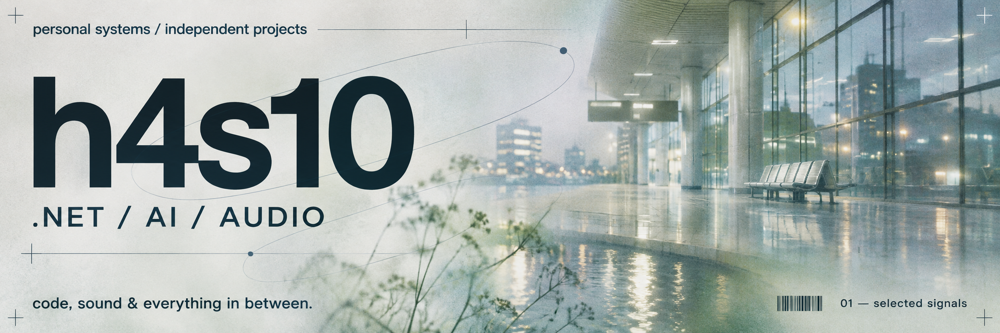

  

  <a href="#01--profile">01 / profile</a> &nbsp; &nbsp; <a href="#02--selected-work">02 / selected work</a> &nbsp; &nbsp; <a href="#03--toolkit">03 / toolkit</a> &nbsp; &nbsp; <a href="https://github.com/h4s10?tab=repositories">all repositories ↗</a>

 

### 01 / profile

I build .NET applications, experiment with AI, and make tools for working with audio plugins. Here you'll find desktop projects, bot integrations and reusable libraries.

**Code, sound & everything in between.**

 

### 02 / selected work

<table>
  <tr>
    <td align="center" width="64">01 AUDIO</td>
    <td>
      <a href="https://github.com/h4s10/NativePluginConverter"><b>NativePluginConverter ↗</b></a> 
      A desktop app for packaging native FL Studio plugins as VST3 bridges. Cross-platform converter; exported bridges currently target Windows x64. 
      C++ &nbsp; / &nbsp; Electron &nbsp; / &nbsp; VST3
    </td>
  </tr>
  <tr>
    <td align="center" width="64">02 AI</td>
    <td>
      <a href="https://github.com/h4s10/AIInterviewAssistant"><b>AIInterviewAssistant ↗</b></a> 
      An experimental interview assistant combining speech recognition with GPT. Built with .NET MAUI and VOSK, with Russian-language support. 
      C# &nbsp; / &nbsp; .NET MAUI &nbsp; / &nbsp; VOSK
    </td>
  </tr>
  <tr>
    <td align="center" width="64">03 API</td>
    <td>
      <a href="https://github.com/h4s10/bot-vkteam-dotnet"><b>bot-vkteam-dotnet ↗</b></a> 
      A .NET interface for VK Teams bots, built on Refit. Typed API calls and examples for handling incoming events. A work in progress. 
      C# &nbsp; / &nbsp; .NET &nbsp; / &nbsp; Refit
    </td>
  </tr>
  <tr>
    <td align="center" width="64">04 DATA</td>
    <td>
      <a href="https://github.com/h4s10/SpecificationPattern"><b>SpecificationPattern ↗</b></a> 
      A specification-pattern library based on EF Core. Compose query criteria, includes and ordering into reusable specifications. 
      C# &nbsp; / &nbsp; EF Core &nbsp; / &nbsp; .NET
    </td>
  </tr>
</table>

 

### 03 / toolkit

**Applications** &nbsp; C# · .NET · .NET MAUI · EF Core · Refit  
**Desktop & audio** &nbsp; C++ · Electron · JavaScript · VST3  
**Web & real-time** &nbsp; TypeScript · SignalR  
**AI & speech** &nbsp; GPT · VOSK

 

Explore the code, try a tool, or open an issue in the relevant repository.

