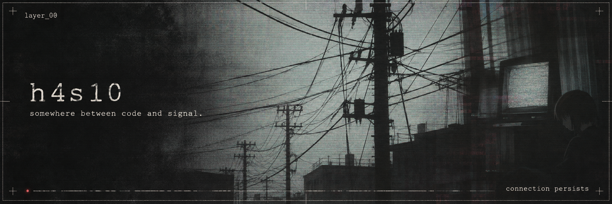
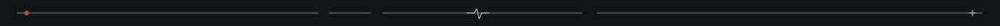

  

 

  <samp>a small disturbance in the wired. 
  fragments of code. residual sound. 
  something is still running.</samp>

 

  <a href="https://github.com/h4s10/NativePluginConverter" title="NativePluginConverter — audio plugin bridges"><samp>[ 01 / signal ]</samp></a>
  &nbsp; · &nbsp;
  <a href="https://github.com/h4s10/AIInterviewAssistant" title="AIInterviewAssistant — speech and AI experiment"><samp>[ 02 / echo ]</samp></a>
  &nbsp; · &nbsp;
  <a href="https://github.com/h4s10/bot-vkteam-dotnet" title="bot-vkteam-dotnet — VK Teams bot interface"><samp>[ 03 / relay ]</samp></a>

 

  
<samp>inspect the signal</samp>

 

| node | trace |
| :--- | :--- |
| [NativePluginConverter](https://github.com/h4s10/NativePluginConverter) | Native FL Studio plugins → VST3 bridges. Cross-platform converter; exported bridges currently target Windows x64. |
| [AIInterviewAssistant](https://github.com/h4s10/AIInterviewAssistant) | Experimental speech + GPT assistant. C#, .NET MAUI, VOSK. Russian-language support. |
| [bot-vkteam-dotnet](https://github.com/h4s10/bot-vkteam-dotnet) | A .NET interface for VK Teams bots, built on Refit. Work in progress. |
| [SpecificationPattern](https://github.com/h4s10/SpecificationPattern) | Composable query specifications for EF Core. |

C# / .NET / C++ / Electron / TypeScript / audio / AI experiments

 

[the rest of the archive ↗](https://github.com/h4s10?tab=repositories)

 

<samp>you can leave the page. the signal stays.</samp>

